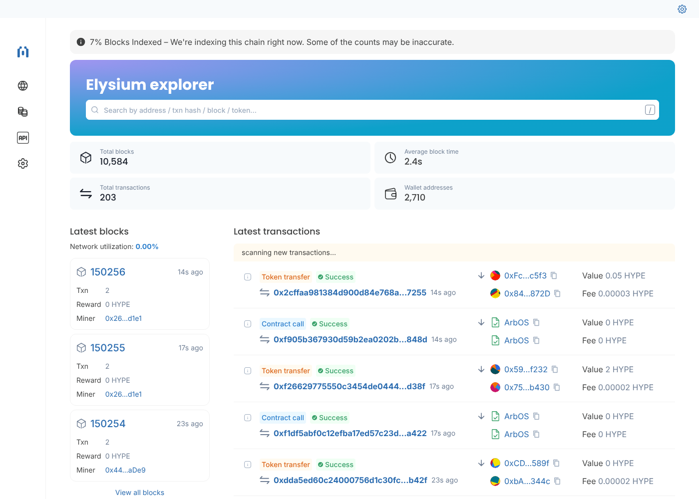

# Elysium Block Explorer (Blockscout)

Self-hosted [Blockscout](https://github.com/blockscout/blockscout) explorer for **Elysium**.

| | |
|---|---|
| Chain ID | 99901 (`0x1863d`) |
| Stack | Arbitrum Nitro (Orbit) → backend image `blockscout-arbitrum` |
| Native token | HYPE, 18 decimals |
| Primary RPC | `https://rpc.chainzy.io` (archive) |
| Fallback RPC | `https://rpc.stockium.fun` (pruned: recent state only) |



## Deploy on a server

Requirements: Linux, 4 CPU / 8 GB RAM (16 GB better), 100 GB SSD, Docker + Compose, a domain pointing at the server.

```bash
git clone <this repo> && cd test-blockscout/elysium
cp .env.example .env          # set EXPLORER_HOST, DB_PASSWORD, SECRET_KEY_BASE
docker compose up -d
docker compose logs -f backend
```

Then HTTPS with Caddy (edit the domain in `Caddyfile` first):

```bash
sudo apt install -y caddy
sudo cp Caddyfile /etc/caddy/Caddyfile && sudo systemctl reload caddy
```

Open `https://<EXPLORER_HOST>`. Full history (~150k blocks) indexes in about 1.5–2 hours; recent blocks show up immediately.

### Local test

```bash
cat > .env <<'X'
EXPLORER_HOST=localhost
EXPLORER_PROTOCOL=http
EXPLORER_WS_PROTOCOL=ws
EXPLORER_PUBLIC_PORT=8080
HTTP_PORT=8080
X
docker compose up -d   # http://localhost:8080
```

## RPC quirks this config handles

- **No tracing** – neither RPC exposes `debug_trace*`, so the internal-transactions fetcher is disabled
  (`INDEXER_DISABLE_INTERNAL_TRANSACTIONS_FETCHER=true`). Internal txs / raw trace tabs will be empty.
- **Batch limit 50** – `rpc.chainzy.io` answers `403 Invalid request` to JSON-RPC batches over 50,
  so `ETHEREUM_JSONRPC_HTTP_BATCH_SIZE` and the fetcher batch sizes are capped at 50 in `envs/backend.env`.
- **Pruned fallback** – `rpc.stockium.fun` returns `missing trie node` for historic balances/code, so it is
  only the fallback. Don't make it primary.
- **Postgres without SSL** – the bundled DB has no TLS; `ECTO_USE_SSL=false` / `sslmode=disable` are set.

## Files

- `docker-compose.yml` – db, redis, backend, frontend, nginx proxy
- `envs/backend.env`, `envs/frontend.env` – chain settings
- `.env.example` – per-deployment settings (host, ports, RPCs, secrets)
- `proxy/default.conf.template` – routes `/api`, `/socket` to backend, everything else to frontend
- `Caddyfile` – HTTPS in front of the proxy
